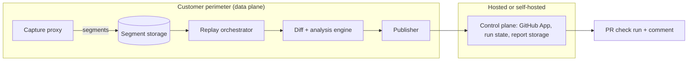

# Parity

Behavioral verification for AI-written code via production traffic replay.

Parity captures sanitized production traffic and, on every pull request,
replays it against the PR's build in an isolated environment, then reports
what actually changed — not what unit tests happened to check.

## Table of contents

- [Status](#status)
- [5-minute quickstart (Phase 1: capture only)](#5-minute-quickstart-phase-1-capture-only)
- [Interactive web report viewer](#interactive-web-report-viewer)
- [GitHub PR check (`parity-ci`)](#github-pr-check-parity-ci)
- [Architecture](#architecture)
  - [Capture → replay → diff → report flow](#capture--replay--diff--report-flow)
  - [Binaries](#binaries)
  - [Target design (full product)](#target-design-full-product)
- [Project structure](#project-structure)
- [Honest limitations (today)](#honest-limitations-today)

## Status

**Status: all 6 phases of the original build plan have a working,
tested slice.** See `docs/plans/` for each phase's plan + honest summary
of what was verified vs. deferred, and `docs/decisions/` for the ADRs
behind every non-obvious choice. **Read `docs/limits.md` before trusting
any of this.** In particular: no real GitHub App has ever been
registered/installed (Phase 4), no Kubernetes cluster was available to
test the Kubernetes environment driver or `helm install` the chart
(Phase 5), and the LLM classifier was never built (no model endpoint in
this environment — only the heuristic baseline exists). Do not treat
this repo as production-ready; treat it as a working, end-to-end-tested
foundation with explicitly named gaps.

Capture → recording (Phase 1), three-way replay + diffing (Phase 2),
performance regression detection + test generation (Phase 3), the
heuristic classifier + GitHub client + MCP server (Phase 4), gRPC
diffing + privacy gating + retention (Phase 5), and a database
record/replay fidelity spike against a real Postgres (Phase 6) are all
implemented, unit tested, and — where the dependency was actually
available in this environment — exercised end to end against a real
upstream service, a real gRPC server, or a real database. Where a
dependency wasn't available (a live GitHub App, a Kubernetes cluster),
that is stated plainly in `docs/limits.md` rather than glossed over.

## 5-minute quickstart (Phase 1: capture only)

```bash
make test   # unit + property-based tests for recording, scrub, capture, config
make demo   # builds the demo service, runs it behind the capture proxy,
            # sends 2000 synthetic requests through it, and inspects the
            # resulting recording segment
```

`make demo` prints a summary like:

```json
{
  "segment": "./segments/seg-000001.zst",
  "record_count": 1899,
  "by_endpoint": { "/users": 704, "/users/{id}": 388, "...": "..." },
  "by_status": { "200": 1812, "404": 87 }
}
```

To look at individual captured exchanges (already scrubbed of PII/secrets):

```bash
./bin/parity inspect ./segments/seg-000001.zst --jsonl
cat ./segments/seg-000001.zst.jsonl | head -1 | python3 -m json.tool
```

## Interactive web report viewer

After a `parity replay` run writes a `report.json`, explore it in a
browser instead of reading raw JSON:

```bash
make webui REPORT=report.json
# open http://localhost:4400
```

Full cluster explorer (search/filter/sort), a before/after JSON example
browser with inline diff highlighting, a performance regression chart,
and a noise-model inspector. No build step, no external dependency —
a single Go binary with the frontend embedded. See
`docs/plans/phase-7-webui.md`.

## GitHub PR check (`parity-ci`)

`cmd/parity-ci` turns a `report.json` into a check run and PR comment —
`action.yml` at the repo root wires `parity replay` + `parity-ci`
together as a drop-in GitHub Action. See
`examples/github-actions/parity-ci.yml` for a consumer workflow and
`docs/plans/phase-8-parity-ci.md` for what's built versus what's still
untested (notably: `action.yml` has never run on a real Actions runner).
This is the first concrete piece of a larger platform idea — see
`docs/parity-labs-architecture.md` — of which this repo's replay engine
is pillar one.

## Architecture

### Capture → replay → diff → report flow

Production traffic is captured and scrubbed once, then replayed against
two baselines and a candidate build so that diffing is always "base vs.
base" (to learn normal noise) and "base vs. candidate" (to find real
behavior change):

```
 client
   │
   ▼
┌─────────────────────┐   async, bounded queue    ┌───────────────┐     ┌──────────────────────┐
│ parity-capture proxy │ ─────fail-open──────────▶ │ scrub.Scrubber │ ──▶ │ recording.Writer      │
│ (reverse proxy, on   │                           │ (PII/secret    │     │ segment-NNNNNN.zst    │
│  the request path)   │                           │  redaction)    │     │ + .idx sidecar        │
└──────────┬───────────┘                           └───────────────┘     └──────────┬────────────┘
           │ forwarded, unmodified                                                   │
           ▼                                                                         │ `parity replay`
    upstream service                                                                 ▼
                                                                          ┌────────────────────────┐
                                                                          │ replay orchestrator      │
                                                                          │ (internal/orchestrate)   │
                                                                          │ three-way: base-A /      │
                                                                          │ base-B / candidate       │
                                                                          └───────────┬─────────────┘
                                                                                      ▼
                                                                          ┌────────────────────────┐
                                                                          │ internal/diff + classify │
                                                                          │ + perf (noise model,     │
                                                                          │ clustering, severity,    │
                                                                          │ perf regression stats)   │
                                                                          └───────────┬─────────────┘
                                                                                      ▼
                                                                          ┌────────────────────────┐
                                                                          │ internal/report          │
                                                                          │ report.json / markdown   │
                                                                          └─────┬──────────┬────────┘
                                                                                │          │
                                                                  `parity report`│          │ `parity-webui`
                                                                   CLI summary ◀─┘          └─▶ interactive viewer
                                                                                             (+ MCP tools via parity-mcp)
```

Base-A vs. base-B diffs train the noise model (what varies run-to-run
even with no code change — timestamps, ordering, etc.); base vs.
candidate diffs are then filtered through that noise model so the report
surfaces genuine behavioral change ("signal") separately from absorbed
noise. See `docs/architecture.md` for the full two-plane design (capture
data plane vs. control plane) and `docs/plans/phase-2.md` for the
replay/diff design in detail.

### Binaries

| Binary | Role |
|---|---|
| `cmd/parity` | User-facing CLI: `inspect` (Phase 1, read a segment), `replay` + `report` (Phase 2, run a three-way replay and summarize/export a `report.json`), `test generate`/`test run` (Phase 3, portable regression test cases), `purge` (Phase 5, retention/right-to-erasure sweeps over segments). |
| `cmd/parity-capture` | Standalone capture reverse-proxy binary. Runs in front of (or as a sidecar to) the service under observation per `parity.yaml`, forwards requests unmodified, and asynchronously scrubs + records a sampled subset off the hot path (fail-open under backpressure). |
| `cmd/parity-mcp` | Exposes Parity to coding agents over MCP (stdio transport): run a replay, fetch/explain a report, run the generated regression suite, acknowledge a cluster. Verified against the Go SDK's in-memory client/server transport; never exercised against a real external MCP client process — see `docs/limits.md`. |
| `cmd/parity-webui` | Interactive HTML report viewer for a `report.json`: cluster explorer, before/after JSON diff browser, performance regression chart, and noise-model inspector. A single static Go binary — the frontend is embedded via `go:embed`, no build step or CDN dependency. |
| `cmd/parity-ci` | Posts a `report.json` as a GitHub check run + PR comment, classifying clusters with the heuristic baseline first (Phase 8). Pure composition over `internal/report`/`internal/classify`/`internal/gh`. Used by `action.yml` at the repo root. Never run against a real GitHub Actions runner — see `docs/plans/phase-8-parity-ci.md`. |
| `cmd/parity-controlplane` | **Not implemented.** Reserved for the hosted/self-hosted run-state machine, GitHub webhook receiver, and report storage described in `docs/architecture.md`'s target design (spec 6.9). The directory exists but is empty — see `docs/limits.md`. |
| `cmd/parity-replay` | **Not implemented as a separate binary.** Replay currently lives as the `parity replay` subcommand of `cmd/parity`; this directory is an empty placeholder, not a built binary. |

GitHub App integration (`internal/gh`) and the heuristic change classifier
(`internal/classify`) are libraries, used directly by `cmd/parity-ci` to
post check runs/comments and by `cmd/parity-mcp`'s tools — see
`docs/limits.md` for what has and hasn't been exercised against a real
GitHub App (the HTTP client itself is unit-tested against a fake server;
it has never authenticated against the real `api.github.com`).

### Target design (full product)



Key invariant: raw traffic never crosses from the data plane into the
control plane. Only diffs, aggregates, and (if configured) redacted
samples do, and that is itself configurable down to "nothing leaves"
(`parity.yaml` `privacy.send_to_control_plane`). The control plane half
of this diagram (`cmd/parity-controlplane`) is the one piece not yet
built — see the Binaries table above and `docs/limits.md`.

## Project structure

```
cmd/
  parity/              CLI: inspect, replay, report, test generate/run, purge
  parity-capture/       capture reverse-proxy binary
  parity-mcp/            MCP server for coding agents
  parity-webui/         interactive report viewer (Go server + embedded static/)
    static/              index.html, app.css, app.js — no build step
  parity-ci/             posts report.json as a GitHub check run + PR comment (Phase 8)
  parity-controlplane/   empty — not implemented (see docs/limits.md)
  parity-replay/         empty — replay lives in cmd/parity today, not here

internal/
  recording/            Exchange schema, zstd segment writer/reader, JSONL export
  scrub/                 PII/secret detection + format-preserving pseudonymization
  capture/                reverse proxy, endpoint templating, sampling, fail-open sink
  config/                 parity.yaml loading + validation
  replay/                 three-way (base-A/base-B/candidate) replay execution
  normalize/              response normalization before diffing
  diff/                   structural JSON diffing + path-aware change detection
  classify/               heuristic change classifier (no LLM endpoint available)
  perf/                   performance regression statistics (p95, effect size, p-value)
  testgen/                portable regression test case generation
  report/                  shared report.json / markdown schema used by every surface
  gh/                      minimal GitHub App client (Checks API, PR comments)
  grpcdiff/                gRPC request/response diffing
  privacy/                privacy gating for what leaves the data plane
  retention/               segment retention + purge
  dbrecord/                database record/replay fidelity (Postgres spike)
  feedback/                cluster acknowledgment (intended vs. confirmed bug)
  stub/                    stubbed dependencies for replay environments

eval/
  demo-service/         realistic JSON API used to exercise the pipeline
  traffic-gen/            synthetic Zipfian-ish traffic generator
  harness/                capture overhead benchmark (p99 added latency)
  grpc-demo/              real gRPC server used to exercise grpcdiff
  mutations/              mutation fixtures for diff/classify tests

python/classifier/      (Phase 4) classifier scaffolding — no model endpoint
                         available in this environment to train/test against

docs/
  architecture.md        full two-plane design (target + what exists today)
  limits.md               the honest list of what's unverified/deferred
  plans/                  phase-by-phase build plans + what was actually verified
  decisions/              ADRs behind non-obvious choices
```

## Honest limitations (today)

- **No live GitHub App.** Not registered, not installed on any repo, no
  webhook ever received, no real check run or PR comment ever posted.
  `internal/gh` is correct against a fake GitHub API (`httptest`) only.
- **No LLM classifier.** Only the required-first heuristic baseline
  (`internal/classify`) exists — no model endpoint was available in this
  environment to build/test one against.
- **`cmd/parity-controlplane` doesn't exist.** The spec's persisted
  `queued → provisioning → ... → done|failed` run-state machine (6.9) was
  never built.
- **No Kubernetes cluster was available.** The Kubernetes `Environment`
  driver and the Helm chart were never run against a real cluster.
- **The capture overhead test** in `eval/harness` runs on developer
  hardware at low concurrency; the production budget (p99 < 1ms added at
  5k RPS on documented hardware) is **not yet verified** at that scale.
- **Scrubbing is text-pattern based, not JSON-path based,** for body
  content — see `internal/scrub/scrub.go`'s doc comment.
- **MCP server untested against an external client.** Verified via the Go
  SDK's in-memory transport, never against a separate client process over
  stdio.
- Inherent limits of behavioral replay apply regardless of phase:
  stateful/write-heavy flows, time-dependent or randomness-dependent
  logic, streaming/WebSockets/GraphQL subscriptions, and non-HTTP
  protocols beyond gRPC are all out of scope or only partially handled.

See `docs/limits.md` for the full, phase-by-phase list — it's the
canonical source and is kept current as phases land; this README section
is a summary, not a replacement for it.
