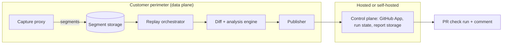
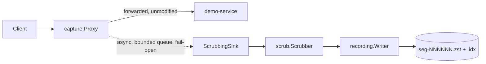

# Architecture

## Target design (full product, phases 1–6)

Key invariant: raw traffic never crosses from the data plane into the
control plane. Only diffs, aggregates, and (if configured) redacted samples
do, and that is itself configurable down to "nothing leaves"
(`parity.yaml` `privacy.send_to_control_plane`).

## What exists today (end of Phase 1)

Only the capture → recording slice:

Everything right of the dashed arrow runs off the client's request path:
`capture.Proxy.ServeHTTP` writes to a bounded Go channel and returns; a
single drain goroutine (`Proxy.Run`) consumes it. If the channel is full
(recorder too slow, sink broken) the exchange is dropped and
`Proxy.Metrics.Dropped` increments — the upstream response the client
received is never affected. This is exercised by
`internal/capture/proxy_test.go::TestProxy_FailsOpenUnderBackpressure`.

## Package map (Phase 1)

| Package | Responsibility |
|---|---|
| `internal/recording` | `Exchange` protobuf schema, zstd segment writer/reader, sidecar index, JSONL export |
| `internal/scrub` | PII/secret detection and format-preserving pseudonymization |
| `internal/capture` | Reverse proxy, endpoint templating, sampling, fail-open sink |
| `internal/config` | `parity.yaml` loading + validation |
| `cmd/parity-capture` | Standalone capture sidecar binary |
| `cmd/parity` | User-facing CLI (`inspect` only so far) |
| `eval/demo-service` | Realistic JSON API used to exercise the pipeline |
| `eval/traffic-gen` | Synthetic Zipfian-ish traffic generator |
| `eval/harness` | Overhead benchmark (p99 added latency) |

Phases 2–6 add `internal/replay`, `internal/stub`, `internal/normalize`,
`internal/diff`, `internal/perf`, `internal/classify`, `internal/testgen`,
`internal/report`, `internal/gh`, `python/classifier`, and
`cmd/parity-controlplane`/`cmd/parity-mcp`, per `docs/plans/`.
